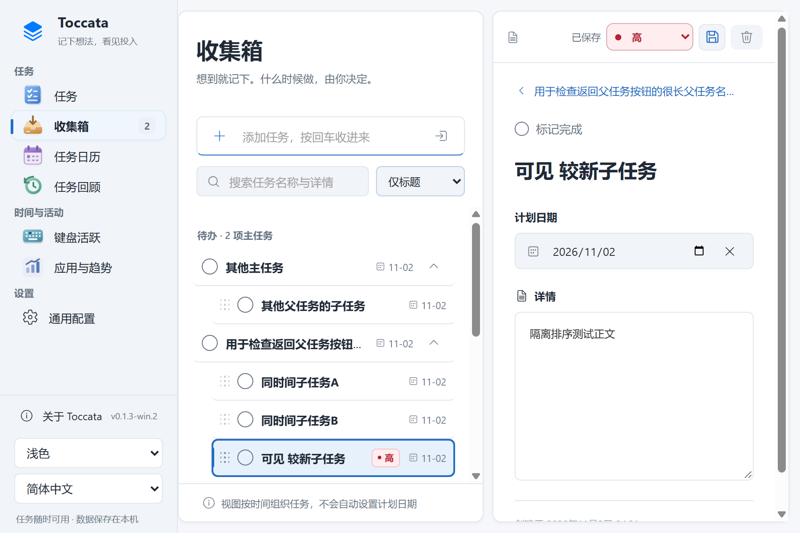
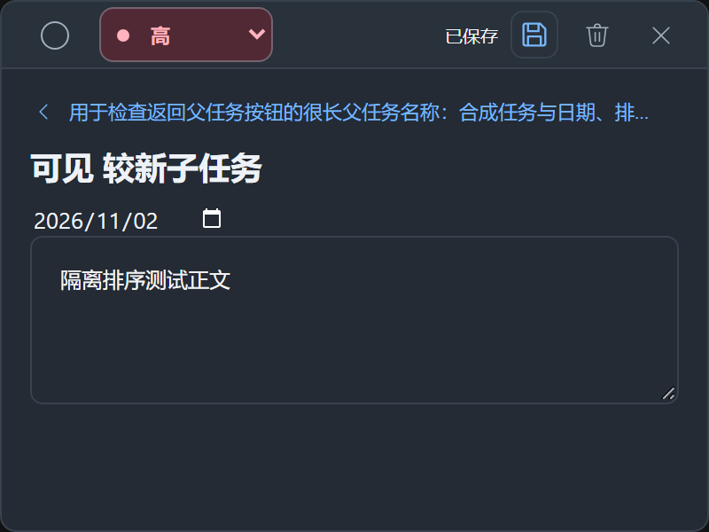

# Windows 任务交互更新

版本：`0.1.3-win.2`；日期：2026-11-02。本轮补齐历史功能审计中的 T2–T7，沿用现有任务数据、自动保存和主题，不修改键盘统计口径或用户数据库结构。[版本发布入口](https://github.com/WenNinghan/Toccata-Windows/releases/tag/v0.1.3-win.2)；程序资产为 `Toccata-Windows-v0.1.3-win.2-x64.zip`，源码为 `Toccata-Windows-source-v0.1.3-win.2.zip`，校验值见 `SHA256SUMS.txt`。

## 排序

普通任务、收集箱、主任务日历和托盘日历统一采用：未完成的根任务按创建时间从新到旧，已完成根任务按完成时间从新到旧，同一时间按 ID 排序。托盘的任务页继续使用用户选择的创建升序、降序或名称排序；名称采用自然排序，例如“任务 2”排在“任务 10”前。

子任务在主列表、详情、日历、托盘及浮窗共用同一顺序：未完成优先，其次手工顺序，再按创建时间从新到旧，同值按 ID。新建且未手动排序的子任务排在已有手工序号前。优先级与编辑更新时间不参与排序；回顾保留父子上下文和原有完成树语义。

## 保存与返回父任务

主窗口任务详情和浮动编辑窗增加保存按钮，也可按 **Ctrl+S**。快捷键在标题、日期/优先级控件和 Markdown 编辑器内均可使用；自动保存继续保留。保存等待已经提交的日期/优先级更改，只回写有改动的字段，避免旧窗口把其他窗口的新内容覆盖。

输入法正在组词时，保存请求会显示等待状态，确认组词后再执行；连续按 Ctrl+S 共用正在进行的保存。保存失败保留当前草稿并显示错误，可重试，不以界面变色代替保存成功。

打开子任务后，详情顶部会显示带父任务名称的返回入口。点击后先保存当前编辑，成功才返回；失败则停留，父任务已被删除时会提示。浮窗通过现有宿主入口切换任务，使窗口实际编辑对象与显示一致。

## 完成与拖拽反馈

完成音效复用单个播放器，音量为 0.6，播放中不会叠加新的音效；音频播放失败不影响任务完成。

子任务增加拖拽把手。拖动到同父任务、同完成状态组内的合法位置时显示上方或下方插入线，保存成功后显示短暂落位反馈。跨父任务或跨完成状态组不显示可放置提示，也不改变顺序；启用系统“减少动态效果”时停用落位动画。

## 验证边界

本轮验收针对排序矩阵、主窗口与浮窗的保存/返回、Markdown iframe 快捷键、合成输入法组词、控件更新等待、失败草稿、跨窗口旧内容保护，以及拖拽合法性和不叠加音效。

2026-11-02，`0.1.3-win.2` 完整串行 `npm test` 共 174 项，173 passed、0 failed、1 skipped，耗时 166.10 秒。跳过项为真实采集 helper 的 ready/quit 握手；输入法组合与音效行为使用可观测的测试事件/替身，不代表全部实体输入法和声卡输出已经验证。更新测试中的版本夹具已改为随当前版本动态生成更高版本，修复后单项及完整回归均通过。

全新目录 `npm ci` 安装 284 个依赖包成功，显式准备 Electron 二进制后，使用这份全新依赖完成构建；原生采集程序 self-test 通过。打包 EXE 的启动、任务写入、退出、重启持久化检查为 1 passed；实际 ASAR 的持续编辑、保存/父导航、排序/拖拽专项另有 17 passed、0 failed。包内 55 个运行文件与对应源码字节一致，ASAR 共 62 条目、58 个文件，未包含运行数据或私人文件。以上验证使用隔离合成数据，不读取日常任务和按键数据库。

历史 `0.1.3-win.1` 的 145 passed / 0 failed / 1 skipped 仅对应上一版，不计入本版结果。

## 界面示例

以下两张截图来自关闭真实采集的隔离环境，任务名称、内容与统计均为合成演示数据。

实体输入法与音频环境、特殊键、多设备、完整睡眠/锁屏生命周期、大规模历史记录、动态多屏 DPI、Mac 历史库导入及代码签名仍有独立验收或实现边界，见 [预览说明](windows-preview.md)。本版继续标识为非官方 Windows Preview。
