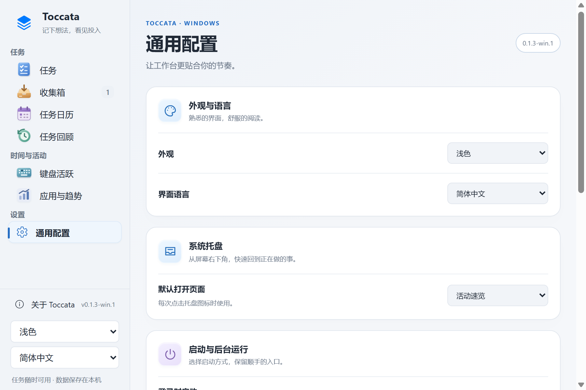
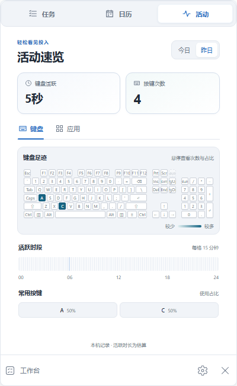
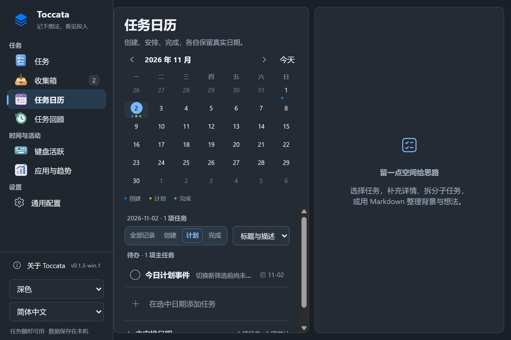

# Windows 对上游 v0.1.3 的迁移

2026-11-02 拉取上游 `35b266d`（v0.1.3 / build 21），参考 v0.1.1、v0.1.2、v0.1.3 的发布说明和 Swift 实现迁移，首先交付 Windows 预览版 `0.1.3-win.1`。后续 `0.1.3-win.2` 补齐任务交互，见 [任务更新说明](windows-task-updates.md) 与 [最新版本发布入口](https://github.com/WenNinghan/Toccata-Windows/releases/tag/v0.1.3-win.2)。Windows 版本号与上游分开标识；此前 2026-10-29 的公开体验包不包含这里的新增功能，需要先手动升级。

## 功能入口

- **左栏 → 通用配置**：外观、语言、托盘默认页、登录启动、隐藏任务栏图标、喝水提醒与关于。原有左下角外观和语言入口仍可使用。
- **托盘 → 活动**：今日/昨日、键盘/应用切换，查看缩略热图、每格 15 分钟的时间线、常用键及全部应用。工作台按钮按当前托盘页面进入对应主页面。
- **键盘活跃**：悬停键帽、常用前五名和分享图片均显示按键使用占比。分母是当前时段的全部有效按键次数，包含当前键盘布局之外的已记录按键；最多保留一位小数。
- **关于 → 检查 Windows 更新**：只检查本移植仓库的 Windows 发布；有兼容 ZIP 与 SHA256 校验值时提供下载、进度、取消、重试和“安装并重启”。没有兼容包时提供发布页链接。
- **任务优先级**：无优先级灰、低蓝、中橙、高红；详情选择框与主列表、子任务、日历、托盘、浮窗共享标识，保留文字辅助，深浅主题均适配。未设置优先级的任务行不增加标签。
- **任务详情与浮窗（`0.1.3-win.2`）**：保存按钮与 Ctrl+S、子任务顶部返回父任务、统一排序和拖拽插入反馈；完成音效复用单个播放器，播放中不叠加。自动保存继续可用。

## 平台适配

Mac 菜单栏映射为 Windows 系统托盘；隐藏 Dock 图标映射为隐藏 Windows 任务栏图标，默认保持显示，托盘仍可恢复主窗口。窗口边框和最小化/最大化操作继续使用 Windows 原生控件。

喝水提醒默认关闭，支持 4096、8192、16384、32768 次按键间隔。开启或修改间隔时从下一个提醒点开始，跨多个点只发最新一次，按本地日期重新计数，进度保存在本机并防止重启重复。提醒使用现有有效按下记录，不重新采集输入文字。Windows 通知设置及专注模式会影响实际显示，可用“发送测试通知”检查。

Fn 的跨硬件采集限制没有改变，Windows 第三指标继续使用之前确认的平均击键频率。键帽材质、自定义布局与按压效果保留。

## 界面与交互

通用配置以卡片分组呈现，使用统一的控件尺寸、主题色、图标与留白；托盘活动采用紧凑布局并将应用列表单独滚动。任务范围、任务日历记录筛选和回顾范围使用主题色分段控件，支持滑动反馈、方向键、Home/End 和“减少动态效果”；日历也提供显示方式选择。“应用与趋势”补充页面标题与说明。

动画仅响应主动切换，不用后台保存重绘输入框。11 月 2 日修复的持续输入、中文合成、计划日期和旧窗口内容保护继续纳入回归。

以下为隔离合成数据界面：

## 更新和数据

Windows 更新只接受 `WenNinghan/Toccata-Windows` 发布的兼容资产，拒绝 DMG、源码 ZIP、错误架构、危险 ZIP 路径和携带运行数据的包。下载完成后校验 SHA256，再准备程序目录。只有用户点击安装后才保存各窗口、停止采集并退出；独立安装程序替换程序目录，保留同级 `Toccata-data`，启动失败时恢复旧程序。旧程序备份保存在程序目录旁的 `.Toccata-update-backup-*`。

更新不会在后台定时检查或自行安装。本地记录与密钥不作为更新附件上传。

## 验证边界

逻辑测试使用合成记录；通知和登录项使用模拟服务。更新测试包含本地假网络、取消、哈希不符、ZIP 校验与真实 Windows 测试程序的替换/失败回滚，不在测试中替换日常运行的程序。系统通知的实际显示、实体输入法与长期多设备场景仍需实机使用验证。

历史记录：`0.1.3-win.1` 于 2026-11-02 发布前完整串行回归共 146 项，145 passed、0 failed、1 skipped（真实采集 helper ready/quit 握手）；该版原生程序重新编译并通过 self-test。此结果来自隔离测试数据，不读取日常任务或按键数据库，不能用作 `0.1.3-win.2` 的最终计数。

参考：[上游 v0.1.3](https://github.com/KMnO4-zx/Toccata/releases/tag/v0.1.3)、[v0.1.2](https://github.com/KMnO4-zx/Toccata/releases/tag/v0.1.2)、[v0.1.1](https://github.com/KMnO4-zx/Toccata/releases/tag/v0.1.1)。
